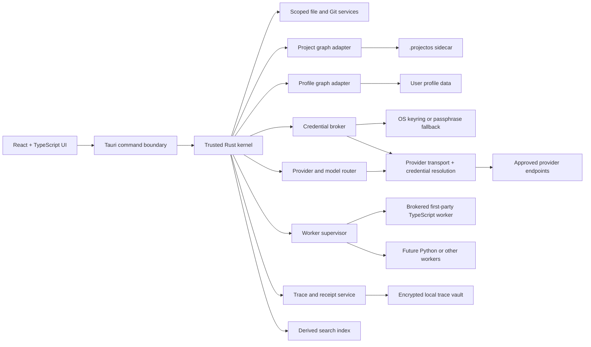

# ProjectOS architecture brief

**Status:** Collaborative design baseline  
**Date:** 2026-10-05  
**Implementation status:** No production scaffold or runtime code exists. This document defines what must be proven before implementation.

## 1. Product thesis

ProjectOS is a local-first desktop operating environment for long-lived creative and technical projects. A project is an ordinary folder with a portable `.projectos/` sidecar. The application adds structure, provenance, automation, and AI-assisted work without replacing ordinary files as the authority for their bytes.

The interaction model is deliberately not “chat with a document.” The primary surfaces are:

1. **Artifacts** — documents, code, previews, diffs, evidence maps, issue tables, and run reports.
2. **Selection actions** — typed operations attached to highlighted text or code.
3. **Recipes** — bounded, inspectable workflows with typed inputs, outputs, budgets, and approval gates.
4. **Context lenses** — small graph views around the current artifact, claim, revision, or run.
5. **Receipts and traces** — observable records of what an agent did, with which authority, evidence, model, tools, and result.

The product supports four project identities:

| Type | Starts with | Intended outcome | Deep MVP support |
|---|---|---|---|
| Academic | Research idea, datasets, or both | Journal submission | Later type pack |
| Software | Idea, design, and technology stack | Open-source program | Yes, second vertical |
| Substack | Short-form writing premise or draft | Published post | Yes, golden path |
| Learning | Topic or question | Educational artifact | Later type pack |

The MVP proves the global kernel and two contrasting type packs: **Substack first**, then **Software**. Academic and Learning projects can be registered and browsed, but their specialized workflows are not presented as complete.

## 2. Product boundaries

### In scope for the MVP

- macOS and Linux desktop application.
- Personal, local-first use with no required account or hosted backend.
- Multiple folder-backed projects per type.
- Portable project metadata and a federated graph model.
- Offline browsing, editing, lexical search, local Git, revision recovery, and trace inspection.
- Online AI through user-selected providers and credentials.
- Selected-text actions for Markdown, text, and LaTeX source. Extractable PDF text can be selected for read-only actions that return annotations or linked artifacts; the MVP does not rewrite PDF bytes in place.
- Whole-artifact recipes for Substack and Software.
- Explicit, reviewable file changes and approval-gated external effects.
- Structured, reproduction-oriented trace receipts without storing or claiming private model chain-of-thought. A rerun is a new run and may not reproduce nondeterministic provider output.
- Apache-2.0 licensed source and contribution model.

### Explicitly deferred

- Deep Academic and Learning type packs.
- Managed team collaboration, shared accounts, or a hosted sync service.
- Local model inference. Offline mode does not imply offline AI in the MVP.
- Arbitrary scripting, unbounded loops, or a general no-code automation platform.
- An unrestricted spatial canvas as the default home surface.
- Silent self-modification of type packs or routing policy.
- General-purpose autonomous computer control. Software UI testing is constrained to an approved target and recipe.
- A SuperGrok subscription integration unless xAI publishes and authorizes a suitable third-party authentication path.
- Mobile clients.

## 3. Core design principles

1. **Files remain files.** Existing source, Markdown, LaTeX, PDFs, data, and publishable outputs remain ordinary user-controlled files.
2. **Artifacts, not prompts, are the collaboration boundary.** Every AI feature declares its inputs, operation, output shape, review mode, and side effects.
3. **Authority is granular.** Reading is different from editing; editing is different from publishing, pushing, deleting, spending, or controlling another application.
4. **Observability is a product surface.** Provenance, evidence, permissions, diffs, failures, latency, and cost are understandable during work—not buried in logs.
5. **The graph is contextual, not decorative.** Small lenses answer concrete questions; a full explorer is available on demand.
6. **Type packs specialize the kernel.** Workflows, tools, models, artifact renderers, and evaluation criteria can differ by project type.
7. **Learning is proposed, reviewed, and reversible.** Cross-project improvements never silently rewrite a workflow.
8. **Portability has a recovery path.** A project remains recoverable without a proprietary cloud service or a specific database build.

## 4. Conceptual architecture



### Process and trust boundaries

| Boundary | Owns | Must not do |
|---|---|---|
| React UI | Presentation, local interaction state, review surfaces | Direct filesystem, credential, shell, Git, or provider access |
| Rust kernel | Capability checks, scoped I/O, graph transactions, revisions, routing, trace coordination | Execute arbitrary workflow code in-process |
| Worker supervisor | Versioned worker protocol, lifecycle, time/memory budgets, cancellation | Grant capabilities that were not issued by the kernel |
| Brokered first-party worker | Typed action or recipe execution | Perform ambient filesystem, network, credential, shell, or external-app access |
| Credential broker | Resolve opaque credential handles at call time | Return raw secrets to the UI, graph, receipts, or worker logs |
| Provider adapter | Translate a typed model request and normalize a response | Change permissions, mutate files, or conceal the provider-reported resolved model |
| Git broker | Repository status, diff, worktree, commit, and separately approved remote actions | Traverse another repository, combine commit with push, or accept unvalidated model-supplied flags |
| Document/parser renderer | Sandboxed Markdown, HTML, PDF, and LaTeX extraction/preview | Execute active content, access network or credentials, invoke privileged IPC, or write source files |
| Computer-use worker | One visible approved target/session, bounded capture, and emergency stop | Ambient desktop control, hidden continuation, target switching, or credential-surface capture |
| Type-pack host | Declarative first-party pack loading and isolated validators/workers | Run pack code in the Rust kernel or widen global permissions |
| Provider transport | Allowlisted egress and credential-handle resolution | Reveal secrets, follow arbitrary redirects, or send content outside the granted scope |

The first worker is written in TypeScript. It is trusted for first-party product behavior but still runs under an enforceable OS/runtime confinement profile; every file, provider, network, Git, shell, and external-app operation is brokered through Rust capability APIs. Capability brokering plus confinement is the authorization boundary; process separation alone is insufficient. Filesystem access uses descriptor-relative, no-follow operations (`openat` or platform equivalent), inode/device verification, and adversarial symlink-swap tests rather than relying on check-then-open canonicalization. Failure to enforce filesystem, network, child-process, environment, and orphan-cleanup constraints on either OS fails Gate C and returns the worker topology to design. The packaging gate chooses between a pinned bundled runtime and a compiled artifact. The protocol does not depend on that choice. Python workers may be added for Academic workflows without changing the kernel or UI contract.

## 5. Global kernel versus type packs

| Global capability | Type-pack specialization |
|---|---|
| Project registry and folder identity | Lifecycle stages and project health criteria |
| Project/profile graph contracts | Node and relation extensions |
| File, revision, and Git services | Artifact adapters and milestone semantics |
| Provider adapters and model routing | Recommended models, prompts, budgets, and fallbacks |
| Capability and approval engine | Risk policy overrides within global limits |
| Action and recipe runtime | Actions, recipes, validators, and output contracts |
| Trace, receipts, and cost ledger | Type-specific evidence and evaluation views |
| Search and retrieval | Corpus selection and ranking policies |
| Versioned first-party pack loader/migrator | Pack definitions and namespaced migrations; third-party installation/signing is later scope |

The configuration hierarchy is:

> Global defaults → type-pack defaults → project overrides → one-run overrides

Every run records the effective configuration after this merge, not merely the defaults.

## 6. Project information model

The user-facing structure is **Scope → Config → Assets → Artifacts**.

| Layer | Meaning | Examples |
|---|---|---|
| Scope | Why the project exists and what “done” means | Premise, audience, research question, non-goals, acceptance criteria |
| Config | How work is allowed to happen | Pack version, model routes, budgets, permissions, Git policy |
| Assets | Inputs not currently being authored as the primary outcome | Sources, datasets, references, screenshots, design files |
| Artifacts | Objects through which people and agents collaborate | Draft, code diff, evidence map, issue table, preview, run report |

### Baseline graph vocabulary

The first schema should stay small and extensible.

**Core nodes:** `Project`, `Scope`, `ConfigSnapshot`, `Asset`, `Artifact`, `ArtifactRevision`, `Selection`, `ActionDefinition`, `RecipeDefinition`, `RecipeRun`, `ToolCall`, `ProviderInvocation`, `Evidence`, `Claim`, `Decision`, `Approval`, `GitRef`, `TypePattern`.

**Core relations:** `HAS_SCOPE`, `USES_CONFIG`, `CONTAINS`, `DERIVED_FROM`, `REVISION_OF`, `SELECTS`, `EXECUTED`, `CALLED`, `PRODUCED`, `SUPPORTS`, `CONTRADICTS`, `APPROVED_BY`, `GOVERNED_BY`, `CHECKPOINTED_AS`, `LEARNED_FROM`.

Type packs can extend this vocabulary through namespaced schema migrations. They cannot redefine global semantics.

## 7. Data authority and storage

ProjectOS uses a **federated graph** rather than one central database.

File bytes are canonical in ordinary project files. `project.toml` is the canonical sidecar-envelope record for project UUID, declared type, content roots, and store/schema compatibility. The project graph is canonical for semantic object identity within the project (excluding the envelope UUID), lifecycle, relationships, configuration snapshots, mutation state, provenance, and durable redacted receipt facts. The object store is canonical only for immutable before/after revision blobs required by local recovery; it is not a second editable artifact filesystem. Project recipe-override files are canonical human-readable definitions; the graph stores the exact version/hash snapshot used by each run. `receipts/`, graph snapshots, and the post-commit operation journal are deterministic audit/recovery representations of committed graph state, not concurrently writable authorities. Raw prompts, responses, tool payloads, screenshots, and recordings are canonical only while retained in the private trace vault.

| Store | Authority | Location | Portability and recovery |
|---|---|---|---|
| Project manifest | Envelope project UUID, declared type/pack, content roots, graph/engine/export compatibility | `.projectos/project.toml` | Travels with the folder; mismatch with graph mirror forces read-only repair |
| Ordinary project files | Code, prose, LaTeX, PDFs, datasets, publishable outputs | Project folder | Native tools and Git remain valid |
| Project graph | Semantic object IDs, relations, lifecycle, configuration, provenance, mutation state, and durable redacted receipt facts | `.projectos/graph/` | Travels only through a quiesced checkpoint; recoverable from a verified snapshot plus journal |
| Project object store | Content-addressed before/after blobs for accepted mutations and named recovery points | `.projectos/objects/` | Retention policy is visible; never edited as an artifact |
| Project recipe overrides | Human-readable first-party recipe definitions and project-specific parameters | `.projectos/recipes/` | Versioned files; each run records definition hash/version in graph |
| Profile graph | Installation-specific registry/path bindings and last-seen checkpoints, cross-project links, global preferences, approved type-level learning | OS application-data directory | Never overrides project UUID; exportable separately |
| Sensitive trace vault | Detailed local events that may contain sensitive inputs or outputs | Encrypted OS application-data directory | Project graph holds redacted receipts and content hashes |
| Derived search index | Lexical index and cached retrieval features | OS cache directory | Disposable and rebuildable |
| Credential store | API keys, refresh tokens, vault keys | OS keyring; passphrase-encrypted fallback on Linux | Graphs contain opaque credential handles only |

### Proposed sidecar layout

```text
.projectos/
├── project.toml                 # UUID, type/pack, schema/engine/export versions, checkpoint, roots
├── graph/
│   ├── engine.toml             # selected adapter and compatible engine version
│   └── store/                  # engine-private live store; ignored by Git
├── objects/                    # content-addressed before/after recovery blobs
├── recipes/                    # human-readable, versioned recipe definitions
├── receipts/                   # redacted run receipts suitable for review/Git
├── recovery/
│   ├── journal.jsonl           # append-only committed-operation journal
│   └── snapshots/              # deterministic graph export checkpoints
└── cache/                      # project-local disposable material, if needed
```

`project.toml` requires a stable `project_id`, namespaced `project_type`, `pack_version`, graph and export schema versions, engine ID/version, latest validated transaction/checkpoint, and approved project-relative content roots. It must not contain secrets, raw traces, machine-absolute identity, or provider-private state required to open the project.

Machine-local state follows the same recovery discipline:

```text
<ProjectOS app data>/
├── profile/
│   ├── graph/<engine-private-store>
│   ├── exports/profile.graph.jsonl
│   └── recovery/{journal.jsonl,snapshots/}
├── vault/<project-uuid>/<run-uuid>/
├── index/
└── cache/
```

The live database is authoritative during normal operation. Its verified mirror of the envelope UUID must match `project.toml`; a mismatch opens read-only and requires repair. Deterministic exports are generated by the database adapter and are never hand-edited; they are the recovery and Git transport. Exports use stable IDs, canonical ordering and encoding, normalized timestamps, explicit schema/export versions, a checkpoint hash, and forward-compatible unknown-field preservation. Import must reproduce equivalent nodes, edges, durable receipt facts, and checkpoint hashes; engine-private bytes need not match. A clone or damaged database hydrates from the newest validated snapshot and replays the post-commit operation journal. This journal is not the embedded engine's WAL and does not own in-flight mutation state.

A reusable structured output must be promoted to an ordinary artifact file plus a graph node. A transient intermediate remains in the trace vault. Neither belongs in the recovery object store merely because it is large.

### Mutation commit protocol

Canonical changes span ordinary files, content-addressed objects, graph state, and recovery records. Project Core is the single writer and coordinates them as follows:

1. Validate base file/selection hashes and store/verify required before-images.
2. Commit a graph transaction creating `Mutation(id, PREPARED, before hashes, intended hashes, capability grant, approval reference)`. The graph is the sole canonical owner of in-flight mutation state.
3. Stage new bytes on the same filesystem, flush them, atomically replace affected files, and transition that graph mutation to `FILES_APPLIED`.
4. Atomically add revision/provenance/durable receipt facts and transition the same graph mutation to `COMMITTED`.
5. Emit the engine-neutral post-commit journal/export checkpoint and only then report success. Derived reindexing happens asynchronously.
6. On startup, inspect incomplete graph mutations and compare current file hashes with recorded before and intended-after hashes. A before hash can be completed or rolled back according to the recorded state; an intended-after hash can complete idempotently. A third hash is preserved as an external conflict copy and requires explicit reconciliation—ProjectOS never overwrites it.

External effects are not part of this local transaction. Every attempt has a ProjectOS attempt ID; a provider idempotency key is sent only when the remote service documents support. After an ambiguous timeout, a non-idempotent spend, publication, push, destructive action, or computer-use effect enters `OUTCOME_UNKNOWN`. ProjectOS first queries remote state where possible and otherwise requires user reconciliation or renewed approval; it never assumes a retry is safe. An implementation that simply “updates both” is non-conforming.

### Profile recovery rules

- Cross-project links exist canonically only in the profile graph. Project graphs may hold clearly marked, non-authoritative cached stubs.
- Loss of the profile graph permits rediscovery of projects by UUID, but does not recreate cross-project links or approved type patterns; those require the latest validated profile export and journal.
- Absolute paths are local bindings, never exported identity.
- A project opens without the profile graph in degraded mode; global links and type learning are reported unavailable rather than silently discarded.

### External file reconciliation

- File watchers are advisory. Project Core re-hashes on open, before action execution, and immediately before apply.
- A mismatch marks graph-derived views and pending proposals stale; ProjectOS never overwrites external bytes.
- On rescan, Core records an `EXTERNAL_CHANGE` revision with observed before/after hashes and actor `external/unattributed`. It claims a recoverable before-image only when one actually exists.
- Rename/move resolution uses project-relative paths plus content/file identity and requires confirmation when ambiguous.
- Search entries for deleted or changed files are invalidated before refresh.
- Recovery guarantees cover ProjectOS-accepted mutations and declared milestones. Unobserved external edits require Git or native backups.

### User-facing backup and repair contract

- Automatic restore points are created before migrations and named milestones; their contents and retention are visible.
- A full portable export contains the manifest, deterministic project-graph snapshot/journal, approved recipe overrides, redacted receipts, and revision blobs included by the selected recovery profile. It excludes credentials, caches, and the private trace vault.
- Restore defaults to a copy with a new path; it previews affected checkpoints and quarantines unverifiable records rather than silently dropping them.
- If repair cannot establish graph invariants, the project stays degraded read-only and can export verified ordinary files plus whatever metadata the adapter can validate.
- Moving a folder to another machine does not move raw traces. Durable receipts truthfully show raw records as unavailable unless the user separately creates and imports an encrypted vault export.

### Folder identity rules

- A stable UUID lives in `project.toml`; a path is not an identity.
- The same UUID at a new path is a reconnect. A raw copy of a live/open database is not a supported portability operation; ProjectOS first quiesces writes and emits a validated checkpoint.
- Two diverged folders with the same UUID require an explicit **fork** or **reconcile** decision.
- Missing or corrupt graph state opens in degraded read-only mode. Preserve and quarantine the corrupt store, offer validated snapshot/journal recovery, and export only what the adapter can verify.
- Migration uses copy-on-write: snapshot → migrate copy → validate invariants → atomic swap.

### Git transport policy

| Class | Default |
|---|---|
| Engine-private graph store, WAL/locks, cache, vault, credentials | Always excluded |
| Manifest, first-party recipe overrides, redacted receipts, deterministic graph snapshots/journal | Eligible only after a project-level preview and policy choice |
| Revision blobs | Included only by a declared recovery/retention profile; otherwise clone recovery is explicitly metadata-only |

ProjectOS proposes this policy but never silently edits `.gitignore`. A clean-clone recovery claim always names the transport profile and verifies both topology and any revision payload bytes that profile promises.

## 8. Interaction grammar

### Selected-text actions

Highlighting text or code opens a compact action lens. An action declares:

- accepted selection and document types;
- structured options such as intent, strength, evidence policy, and output length;
- selected model route and budget;
- read/write capabilities;
- output contract: annotation, replacement, diff, issue, or linked artifact;
- review policy and trace level.

The MVP actions are `Rephrase`, `Explain`, `Complete`, and `Fact-check`. A result is never inserted silently. The user sees a diff, citations when applicable, confidence/uncertainty notes, and accept/reject controls.

### Whole-artifact recipes

Recipes are typed directed acyclic graphs in the MVP. Users can:

- inspect the complete typed graph before running;
- set typed parameters, provider/model routes, ordered fallbacks, budgets, bounded retries, and approval gates;
- enable or disable approved optional blocks in a first-party recipe;
- duplicate a first-party recipe as a versioned project override;
- inspect each block's inputs, output contract, and capabilities.

Arbitrary topology/port wiring, third-party block composition, code blocks, unrestricted loops, and hidden retries are excluded. A future topology editor requires its own schema, migration, sandbox, and validation acceptance criteria.

### Contextual graph lenses

The normal workspace shows one or two hops around the current object. Lenses answer distinct questions:

| Lens | Question |
|---|---|
| Current work | What is directly relevant to this artifact now? |
| Lineage | Where did this passage, file, or result come from? |
| Evidence | Which claims have support, conflict, or missing evidence? |
| Workflow | Which recipe, action, and approval produced this state? |
| Activity | What changed, when, and by whom or what? |
| Impact | What downstream artifacts depend on this proposed change? |

Every lens has an equivalent list, table, or timeline. Meaning never depends on spatial layout or color alone.

## 9. Observability and trace contract

Every action and recipe run receives an immutable run ID. The project graph stores a durable, immutable, redacted receipt record. The vault stores an append-only raw event stream only for the configured retention period. Expiration or user deletion creates a durable receipt tombstone stating that raw replay is unavailable; it never rewrites history as though the trace did not exist.

### Required receipt fields

- action or recipe definition ID and version;
- effective configuration hash plus safe disclosed fields;
- input and output references and content hashes;
- provider endpoint class, requested model, provider-reported resolved model, and fallback events;
- tool names, result hashes, and redacted result facts;
- capabilities requested, granted, denied, and exercised;
- evidence references and citation-validation state;
- validator findings plus proposed/accepted diff hashes;
- approvals and local actor/session label;
- errors, retries, cancellation, timing, token usage, and cost where provided;
- final status and raw-vault availability/tombstone.

### Private vault fields

- actual prompts and responses;
- normalized tool payloads and sensitive provider metadata;
- screenshots or computer-use recordings;
- optional encrypted content snapshots and structured intermediates.

A receipt export never pulls private-vault fields transitively.

The trace UI has three levels:

1. **Summary** — outcome, side effects, model route, cost/time, approvals, and errors.
2. **Evidence** — sources, claims, tool results, diffs, and validator findings.
3. **Raw retained record** — loaded from the encrypted vault only after explicit reveal/unlock; secrets are redacted and the record may be unavailable under the retention policy.

“Raw” does not mean private chain-of-thought. ProjectOS records observable requests, responses, structured intermediates, tool activity, and decisions; it neither requests nor claims access to hidden reasoning.

## 10. Authority and approval model

| Risk tier | Examples | Default behavior |
|---|---|---|
| Observe | Read explicitly scoped content, inspect graph, compute local analysis | Automatic within a named project/corpus grant; fully traced |
| Propose | Generate annotation, issue list, alternative passage, test plan | Automatic proposal; no mutation |
| Modify reversible | Apply a reviewed local edit with a retained before-image; update project graph | Explicit acceptance and atomic mutation protocol |
| Destructive local | Purge/delete or overwrite without retained recovery | Just-in-time explicit approval with stated loss |
| External effect | Provider/web request, push, PR, publish, remote delete | Destination/payload scope visible; attempt ID and provider-aware unknown-outcome handling |
| Interactive control | Computer use | Approved target/session, bounded capture, and visible emergency stop |

Capability grants include resource scope, operation, expiry, budget, and reason. Data egress additionally names destination host/provider, exact project/file/selection scope, and retention class. An approved provider is not blanket permission to send every project. Cross-project retrieval reads only an explicitly authorized corpus; sending retrieved passages to a model is a separate egress decision. A recipe cannot widen its own grant. Denial is a normal trace event, not an exceptional hidden failure.

## 11. Provider and model strategy

The model layer is adapter-based and BYOK-oriented.

| Adapter | MVP intent | Authentication |
|---|---|---|
| OpenRouter native | Primary multi-model surface, explicit model IDs, ordered fallbacks | API key and OAuth PKCE where supported |
| OpenAI-compatible | User-defined compatible endpoint | API key or endpoint-defined bearer token |
| Nous API | Supported MVP path after conformance testing | Nous Portal API key |
| Nous/Hermes subscription proxy | Experimental adapter only after protocol, authorization terms, and stability are verified | Documented proxy credential/endpoint; never session-cookie extraction |
| xAI | API-key adapter if desired | Official xAI API credentials |
| SuperGrok subscription | Not promised | Only after a documented, authorized third-party path exists |

Model routes are fixed per action or recipe by default. A route contains an ordered fallback list and an optional cost ceiling. Auto-routing, including OpenRouter Auto or a Jev-based router, is opt-in and must record the provider-reported resolved model and any routing explanation exposed by the provider. ProjectOS does not claim it can independently verify which backend model served a request.

Relevant official references: [OpenRouter OAuth](https://openrouter.ai/docs/guides/overview/auth/oauth), [OpenRouter Auto Router](https://openrouter.ai/docs/guides/routing/routers/auto-router), [Jev Router listing](https://openrouter.ai/typesafe/jev-router), [Nous subscription proxy](https://hermes-agent.nousresearch.com/docs/user-guide/features/subscription-proxy), and [xAI's documented Grok integration with Warp](https://x.ai/news/grok-warp). The existence of one xAI partner integration is not treated as evidence of a general SuperGrok OAuth program.

## 12. Offline and online behavior

| Operation | Offline | Online |
|---|---:|---:|
| Browse/edit files and artifacts | Yes | Yes |
| Project graph and contextual lenses | Yes | Yes |
| Lexical/global metadata search | Yes | Yes |
| Cached semantic results | View only | Refreshable |
| New AI transform, evaluation, or RAG answer | No | Yes |
| Prepare an AI action request | Yes | Yes |
| Local revision history and Git | Yes | Yes |
| GitHub fetch/push/PR | No | With approval |
| Trace and receipt inspection | Yes | Yes |
| Export/copy a publication package | Yes | Yes |
| Publish to a remote service | No | With approval |
| Supervised local computer-use test | Only for a network-denied allowlisted test target, with approval | With approval |
| Remote browser/computer-use service | No | With approval |

Prepared offline actions remain drafts. Reconnection never sends them automatically; the user reviews the current input hash, provider, model route, and budget before execution.

Offline mode denies all external egress by ProjectOS and its managed children centrally in the Rust broker, including providers, telemetry, crash upload, update checks, model-catalog refresh, OAuth refresh, remote fonts/images, link previews, redirects, plugin endpoints, and remote Git. Tests cover DNS plus IPv4 and IPv6. Local Git in offline mode disables or audits executable hooks, filters, textconv, credential helpers, and filesystem-monitor integrations. ProjectOS cannot claim control over an arbitrary external app's networking, so offline computer use is available only for an approved target launched in a network-denied test profile; otherwise it is unavailable. User-configured local AI endpoints are excluded from the MVP and remain disabled in offline mode; adding local inference later requires a new offline contract.

## 13. Versioning semantics by type

### Substack

- Every accepted AI edit creates an immutable local revision and a graph edge to its source.
- The timeline is automatic; users add named milestones such as `argument locked`, `editor pass`, or `publish candidate`.
- Accepting one suggestion never overwrites the recovery point that preceded it.
- Every accepted AI mutation retains its immediate before-image, and every named milestone retains a complete restorable snapshot. Automatic intermediates follow a visible size/time policy; purging first shows lost restore points and records a tombstone.
- Git checkpoints are optional and should not create a commit for every keystroke.

### Software

- Agents propose patches in a review surface or work in an isolated Git worktree.
- Commits are explicit outcomes; push, PR creation, release, and deployment require approval.
- Tests and computer-use checks attach results to the exact commit/tree hash.
- A diff can be reviewed by file, semantic unit, recipe step, or agent run.

An agent worktree is ephemeral execution staging linked to its originating project and run. It is never registered as another ProjectOS project and contains no independent canonical `.projectos` graph. The worker receives only the worktree capability. Accepting results requires the Git broker to apply/cherry-pick the reviewed change into the declared canonical checkout—or explicitly update the project's chosen ref—after base-ref/hash revalidation. Only then does Project Core record graph revisions and durable receipt facts.

## 14. Type-pack golden paths

### Substack first

1. Register an existing folder or create a new one.
2. Capture premise, audience, promise, and boundaries in Scope.
3. Open a Markdown draft as the focal artifact.
4. Use a selected-text action and review its diff.
5. Run a whole-draft structural/adversarial review that returns an issue table and evidence map.
6. Accept selected changes; inspect lineage and the run receipt.
7. Create a named publish-candidate milestone.
8. Export/copy publishable content; direct publishing is a later approval-gated adapter.

### Software second

1. Capture product idea, design constraints, target platform, and stack.
2. Register the repository and choose the Git policy.
3. Generate a scoped implementation plan as an artifact, not a free-form chat transcript.
4. Execute a bounded recipe in an isolated worktree.
5. Review patches, test output, capability use, and trace evidence.
6. Optionally run a supervised computer-use recipe against an explicitly approved local app/window.
7. Commit locally; separately approve push or PR creation.

## 15. Type-level self-improvement

ProjectOS may derive candidate patterns from completed projects—for example, a better structural-review rubric or a recurring Software validation block. It must:

1. extract a redacted pattern with provenance;
2. explain the supporting projects and counterexamples;
3. propose a versioned type-pack change;
4. show affected actions/recipes and a semantic diff;
5. require explicit approval;
6. retain rollback to the previous pack version.

Raw project content does not move into the profile graph by default. Approved patterns reference project/run IDs and sanitized features; opening the source requires separate project access.

## 16. Technology baseline

| Layer | Baseline | Reason |
|---|---|---|
| Desktop shell | Tauri 2 | Rust capability boundary and macOS/Linux target; distribution-size advantage remains a measurement hypothesis |
| UI | React + TypeScript | Mature accessible component ecosystem and strong artifact rendering options |
| Trusted kernel | Rust | Scoped filesystem/process control, packaging, recovery, and performance |
| Worker protocol | Versioned, language-neutral messages | Isolates action logic and permits future Python workers |
| First worker | TypeScript | Shares contracts with UI/type-pack tooling and suits both initial verticals |
| Graph | Adapter contract; LadybugDB vs HelixDB only if each proves supported in-process embedding | Preserve the locked canonical embedded graph database without prematurely coupling queries to one engine |
| Search | Derived local full-text index; vector layer behind an adapter | Offline recovery and engine independence |
| Version control | libgit2 or audited Git CLI wrapper, selected by feasibility gate | Native local Git with explicit external effects |
| Secrets | OS keyring with passphrase-encrypted fallback | No credentials in graphs, files, receipts, or logs |

Tauri's architecture and capability model are documented at [Tauri architecture](https://v2.tauri.app/concept/architecture/) and [Tauri capabilities](https://v2.tauri.app/security/capabilities/). The Linux shell depends on WebKitGTK, so Linux behavior is a release gate rather than an assumption.

## 17. Feasibility gates before feature implementation

### Gate A — Linux desktop shell

Before the test begins, freeze a checked-in platform matrix with exact macOS versions, Linux distribution releases, WebKitGTK versions, CPU architectures, package formats, desktop environments, and X11/Wayland sessions. Test on clean virtual or physical machines without developer packages; build Linux artifacts on the oldest supported target.

**Pass:** installation, signing/notarization, file dialogs, drag/drop, clipboard, IME, native menus, Markdown/LaTeX editing, PDF text selection, large virtualized lists, WebView accessibility tree, 200% zoom, IPC cancellation, and GPU/no-GPU launch all meet the frozen matrix. Untrusted Markdown, HTML, and PDF fixtures are sanitized, use a strict content-security policy with no remote assets, cannot navigate unexpectedly, and cannot invoke privileged IPC.  
**Fail:** a critical accessibility, packaging, rendering, or stability defect has no bounded workaround.  
**Fallback:** document the defect and evaluate Electron against the same matrix; do not maintain both shells.

### Gate B — local graph database evaluation

Pre-screen **LadybugDB** and **HelixDB**, then implement the same narrow adapter and corpus only for candidates that prove a supported in-process embedded mode. A sidecar/server-only integration, Docker/Podman dependency, administrator install, runtime download, or listening port is a hard fail for this locked architecture. LadybugDB must pin compatible core/wrapper versions, vendor and checksum any FTS/vector extensions, prohibit build/runtime “latest” downloads, and pass symbol/signing checks on every package target. HelixDB is eliminated at pre-screen unless it demonstrates a supported embedded library rather than its server/SDK path.

Required operations:

- transactional node/edge upsert and deletion;
- one/two-hop context queries;
- lineage and impact traversal;
- full-text integration or clean companion-index mapping;
- concurrent read plus controlled write;
- crash/reopen and journal replay;
- deterministic export/import;
- copy-on-write migration;
- macOS universal and Linux packaging;
- bounded memory on a representative multi-project corpus.

**Hard fail:** unrecoverable corruption, incorrect traversal results, non-deterministic recovery, license incompatibility, unsupported target packaging, or a migration that cannot be validated before swap.  
**Selection rule:** choose the engine that passes every hard gate and has the lower operational risk. Performance decides only after correctness, recovery, licensing, and packaging. If neither candidate passes, return to the collaborative design stage; do not silently replace the locked graph model with another store.

Current candidates: [LadybugDB](https://github.com/LadybugDB/ladybug) and [HelixDB](https://www.helix-db.com/). Their inclusion is a hypothesis to test, not a commitment.

### Gate C — worker packaging and isolation

**Pass:** a TypeScript worker ships on both OSes, negotiates protocol versions, receives no inherited secrets, and performs all privileged operations through capability handles. Tests cover symlink/path escape, inherited environment, DNS/IPv4/IPv6/localhost egress, redirects, child-process spawning, parent-crash orphan cleanup, full process-tree cancellation, output backpressure, and enforceable time/memory ceilings.  
**Fail:** the worker needs ambient filesystem/network authority, can spawn an ungoverned descendant, survives cancellation, escapes its scope, or produces an uninspectable distribution.

Computer-use testing has a separate hard gate: target window/process identity is explicit, consent is visible, an emergency stop is always available, captures are scoped and redacted, and loss of target identity pauses the run. Linux tests split X11 from Wayland by compositor/portal and cover accessibility/screen-capture permission denial and revocation. Credential exclusion means using an allowlisted test application/profile, not claiming universal password-field detection. If the frozen Linux matrix cannot satisfy this gate, Linux computer use is explicitly deferred while the rest of the Software vertical remains eligible.

### Gate D — graph recovery

**Pass:** inject failure before and after the `PREPARED` graph transaction, staged-file flush, object/file rename, `FILES_APPLIED` transition, `COMMITTED` transaction, fsync, post-commit journal emission, snapshot creation, and atomic swap. Also test disk-full, torn/truncated journal, permission loss, a second writer, cloud-synced/network filesystems, N-1/N-2 migrations, corrupt live database, and folder move. A full local recovery profile reproduces every acknowledged ProjectOS mutation within its active retention window without secret leakage. Clean-clone hydration satisfies its selected Git transport profile: a full profile restores promised bytes; a metadata-only profile restores topology/checkpoints and creates truthful tombstones for unavailable blobs.  
**Fail:** any acknowledged user change becomes irrecoverable or identity resolution silently merges divergent projects.

The recovery suite also restores a profile graph into a clean app-data directory; verifies cross-project links, global preferences, and approved type patterns; proves truthful receipt tombstones after vault/key loss; tests a stale selection and external file change during a run; preserves a third-hash external conflict; handles missing revision blobs; rejects symlink/case-insensitive aliases and symlink-swap races; rolls back type-pack schema migration; removes derived chunks after source revocation; and blocks same-UUID divergent lineage. External-effect tests cover both documented idempotency and `OUTCOME_UNKNOWN` reconciliation without automatic retry. The same sidecar must export/import across macOS and Linux. Two diverged Git branches/journals must result in an explicit reconnect, fork, or semantic reconcile decision—never a binary database merge.

### Gate E — provider contract

**Pass:** mocked and live opt-in tests verify credential isolation, timeout/cancel, streaming, normalized usage/cost, ordered fallback, provider-reported model recording, and redacted receipts. OpenRouter OAuth uses PKCE S256, random state, a one-shot random loopback port, exact redirect validation, and tested logout/revocation. Redirects and endpoint changes cannot receive existing credentials. Linux without Secret Service offers a passphrase vault with tested KDF, authenticated encryption, locking, and recovery behavior—never plaintext. Cost records distinguish route-time estimate, provider-reported usage, billed amount when available, and explicit unknown values; token and spend ceilings stop further calls.  
**Fail:** raw credentials reach UI/worker logs, a fallback is hidden, or offline drafts transmit automatically.

## 18. Delivery sequence

| Milestone | Outcome | Exit criteria |
|---|---|---|
| M0: proofs | Shell, graph, worker, provider, and recovery spikes | Gates A–E decided with reproducible fixtures and recorded evidence |
| M1: kernel skeleton | Folder registration, sidecar, capability broker, graph/profile split, trace viewer | Open/move/recover a project and restore the profile graph; no provider required |
| M2: Substack golden path | Editor, selected-text actions, draft review recipe, revisions, milestones | Complete the eight-step Substack path with a reproduction-oriented receipt |
| M3: Software vertical | Repository adapter, worktree workflow, tests, constrained UI check | Produce and review a patch without silent commit/push/external control |
| M4: hardening | Accessibility, packaging, import/export, contribution docs | macOS/Linux installers and disaster-recovery exercise pass |
| Later packs | Academic and Learning specialization | Separate scoped design stages and acceptance criteria |

## 19. MVP acceptance criteria

The MVP is complete only when all of the following are demonstrated on macOS and Linux:

- Two independent projects of all four types can be registered, moved, reopened, and recovered; two Substack and two Software projects complete their deep golden paths.
- Existing files can be edited without conversion or lock-in.
- A selected-text action produces a typed proposal, visible diff, approval event, revision, and redacted receipt.
- A whole-artifact recipe can be inspected before execution and cancelled during execution.
- Every provider-reported resolved model, fallback, external tool, permission, file mutation, cost state, and error is visible from the trace panel.
- Markdown/text and LaTeX-source selection actions pass stale-anchor tests; extractable PDF selection produces a linked annotation/artifact without mutating PDF bytes; an image-only PDF reports that OCR is required and does not fabricate selectable text.
- Offline mode makes no external egress. Provider calls, remote Git, remote publishing, and remote computer use are unavailable; supervised control of an approved local app remains separately approval-gated.
- Substack revision history restores every named milestone and every accepted edit whose visible retention window remains active; purged points are previewed and tombstoned.
- Software changes can run in isolation and cannot push, publish, delete, or control an app without a scoped approval.
- Damaged project and profile graphs can be restored from validated snapshots and journals; a missing raw vault never creates a false reproduction claim.
- A proposed type-pack improvement shows provenance, semantic diff, approval, version, and rollback.
- Removing a project that supported a type-level pattern either recomputes the pattern or marks its evidence incomplete; it never leaves an apparently fully supported global rule.
- With at least two projects of every type registered, scoped cross-project search returns project ID, relative file URI, content hash, source link, and current/stale state. Excluded projects contribute neither lexical hits nor model context.
- Deleting and rebuilding the derived index from authorized project/profile sources produces equivalent fixed-corpus results and never resurrects revoked or deleted sources.
- Keyboard-only navigation, visible focus, screen-reader labels, reduced motion, and 200% zoom pass the documented accessibility checks.
- The repository includes Apache-2.0 licensing, contributor setup, threat model, data-format documentation, and recovery instructions.

## 20. Visual direction for the prototype

The initial interface direction is **Instrumented Atelier**: warm paper surfaces, dark workshop chrome, editorial typography for authored material, and restrained moss/coral signals for state and action. The active artifact is the visual focal point; observability stays adjacent without becoming a dashboard wall.

Two later directions can be compared without changing the interaction model:

1. **Quiet Laboratory** — cooler neutral surfaces, denser tables, sharper analytical hierarchy, optimized for Academic work.
2. **Spatial Studio** — darker canvas, floating artifacts, stronger graph presence, reserved for users who explicitly choose a canvas-led home.

The prototype implements only Instrumented Atelier so the next critique compares a coherent system rather than three shallow skins.

## 21. Decision log

All entries originate in the collaborative design session dated 2026-10-05. Changing a locked product decision requires an ADR that names affected invariants, migration/compatibility effects, and acceptance-test changes. An evidence-gated baseline changes only through its stated gate.

| ID | Decision | Status | Change/evidence rule |
|---|---|---|---|
| D-01 | Folder-backed projects with `.projectos/` sidecar | Locked product decision | ADR required |
| D-02 | Offline work, but no local AI in MVP | Locked product decision | ADR required |
| D-03 | Substack then Software as deep MVP verticals | Locked product decision | ADR required |
| D-04 | All four types support multiple registered projects | Locked product decision | ADR required |
| D-05 | Personal/local-first; no required backend | Locked product decision | ADR required |
| D-06 | Artifact-centered workspace | Locked product decision | ADR required |
| D-07 | Risk-tiered authority, data-egress scope, and approval | Locked product decision | ADR required |
| D-08 | Typed selection actions plus bounded first-party recipes | Locked product decision | ADR required |
| D-09 | Graph-first conceptual model with contextual lenses | Locked product decision | ADR required |
| D-10 | Type-specific versioning | Locked product decision | ADR required |
| D-11 | Hybrid provider adapter and BYOK | Locked product decision | ADR required |
| D-12 | Fixed routes and ordered fallbacks by default | Locked product decision | ADR required |
| D-13 | Approved, versioned, reversible type-level learning | Locked product decision | ADR required |
| D-14 | Durable redacted receipts; separately retained raw traces; no hidden chain-of-thought claim | Locked product decision | ADR required |
| D-15 | Tauri 2 initial baseline; Electron only if Gate A fails | Evidence-gated baseline | Gate A evidence |
| D-16 | Canonical embedded/in-process project graph database behind an adapter | Locked product decision | Sidecar-only candidates fail; if all fail, return to design |
| D-17 | Federated project/profile graph topology | Locked product decision | ADR required |
| D-18 | LadybugDB–HelixDB contract-first evaluation | Locked evaluation plan | Gate B may eliminate either candidate |
| D-19 | Graph engine selection | Open implementation choice | Gate B evidence |
| D-20 | Language-neutral brokered workers; first worker TypeScript | Locked product decision | Enforcement/packaging remains Gate C |
| D-21 | Git implementation library and transport profile | Open implementation choice | M0/M6 recovery evidence |
| D-22 | Apache-2.0 | Locked product decision | ADR and legal review required |

The graph engine, Linux shell viability, worker packaging method, and Git implementation library are evidence-gated engineering decisions—not unanswered product questions.
